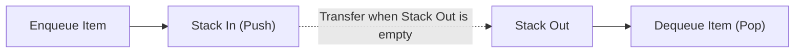

# 📚 Data Structures & Algorithms in Python — Implementation Catalog

<p align="center">
  
</p>

<p align="center">
  A comprehensive collection of 34 practical Jupyter notebook implementations, algorithmic solutions, and asymptotic time-complexity analyses for fundamental Data Structures and Algorithms in Python 3.
</p>

<p align="center">
  <a href="https://github.com/prakruthidevanga/Data-structures-using-python">
    
  </a>
</p>

<p align="center">
  
  
  
  
</p>

---

## 📌 Table of Contents

- [📖 Project Overview](#-project-overview)
- [🎯 Objectives](#-objectives)
- [📂 Categorized Algorithmic Index](#-categorized-algorithmic-index)
- [🏗️ Architectural Concept: Dual-Stack Queue](#️-architectural-concept-dual-stack-queue)
- [🛠️ Technology Stack](#️-technology-stack)
- [📁 Repository Structure](#-repository-structure)
- [⚙️ How to Run & Verify](#️-how-to-run--verify)
- [🔮 Future Enhancements](#-future-enhancements)
- [🤝 Contributing](#-contributing)
- [👩‍💻 Author & Accreditations](#-author--accreditations)

---

## 📖 Project Overview

Proficiency in data structures and algorithm design is the cornerstone of computer science and high-performance software engineering. Understanding memory layout, pointer references, and runtime trade-offs allows engineers to select optimal data models for real-world applications.

This repository catalogs **34 individual problem implementations** across core linear data structures: Stacks (LIFO), Queues (FIFO), Linked Lists, and Arrays. Beyond textbook examples, the repository demonstrates real-world software patterns such as dual-stack Undo/Redo mechanisms, monotonic queues tracking running maximums, and parenthetical string parsers.

📚 **Core Mission:** Provide clear, modular Python implementations of core data structures with explicit time and space complexity evaluations.

---

## 🎯 Objectives

- 📚 **Linear Collections:** Implement stack and queue abstractions using arrays, Python lists, and pointer-linked nodes.
- ⚡ **Asymptotic Optimization:** Achieve optimal $O(1)$ amortized operations (e.g., Min-Stack and Two-Stack Queues).
- 🔄 **Practical Application Patterns:** Build real-world workflows such as command Undo/Redo history tracking.
- 🧪 **Boundary Condition Handling:** Robustly validate edge cases (empty collections, singletons, duplicate elements).

---

## 📂 Categorized Algorithmic Index

| Data Structure Category | Notebook Implementation | Algorithmic Problem Solved | Runtime Complexity |
| :--- | :--- | :--- | :---: |
| **Stacks (LIFO)** | `Undo_Redo System Using Two Stacks.ipynb` | Application state management via complementary stacks | $O(1)$ push/pop |
| | `balance paranthesis.ipynb` | Bracket syntax matching and validation | $O(N)$ time, $O(N)$ space |
| | `Next Greater Element .ipynb` | Monotonic decreasing stack parsing | $O(N)$ linear time |
| | `Minimum element in the stack .ipynb` | Auxiliary min-stack supporting minimum queries | $O(1)$ time retrieval |
| | `check if a stack is a palindrome.ipynb` | LIFO character reversal and palindrome verification | $O(N)$ time |
| | `stack sort algorithm .ipynb` | In-place auxiliary stack sorting | $O(N^2)$ worst-case |
| **Queues (FIFO)** | `Queue using Two Stacks.ipynb` | Amortized FIFO queue using dual LIFO stacks | $O(1)$ amortized pop |
| | `Queue_using_linkedlist.ipynb` | Dynamic memory node-pointer queue implementation | $O(1)$ enqueue/dequeue |
| | `Design a Queue that Supports max() Operation.ipynb` | Monotonic double-ended queue tracking maximum | $O(1)$ max retrieval |
| | `Implement a Queue to Reverse Words in a Sentence.ipynb` | String token stream reversal using FIFO buffer | $O(N)$ time |
| | `merge2queues.ipynb` | Sorted interleaving and merging of two queue streams | $O(N + M)$ time |
| **Arrays & Lists** | `array operations.ipynb` | Dynamic element traversal, slicing, and mutation | $O(N)$ time |
| | `_remove duplicate elements in array.ipynb` | In-place linear duplicate removal | $O(N)$ time |
| | `finding max and min of an array.ipynb` | Minimum comparison bounds for array extrema | $O(N)$ time |
| **Recursion** | `Recursion(1).ipynb` | Call stack mechanics and base-case convergence | Variable |

---

## 🏗️ Architectural Concept: Dual-Stack Queue



---

## 🛠️ Technology Stack

<p align="center">
  
</p>

| Component | Technology | Implementation Details |
| :--- | :--- | :--- |
| **Programming Language** | Python 3 | Core algorithmic implementations and class designs |
| **Development Interface** | Jupyter Notebook | Interactive testing, assertions, and visual printouts |
| **Core Concepts** | DSA & Complexity Theory | Big-$O$ time/space profiling, pointer mechanics |

---

## 📁 Repository Structure

```text
Data-structures-using-python/
├── Undo_Redo System Using Two Stacks.ipynb
├── Queue using Two Stacks.ipynb
├── Queue_using_linkedlist.ipynb
├── Design a Queue that Supports max() Operation.ipynb
├── Minimum element in the stack .ipynb
├── Next Greater Element .ipynb
├── balance paranthesis.ipynb
├── Recursion(1).ipynb
├── [26 additional notebooks...]
└── README.md
```

---

## ⚙️ How to Run & Verify

1. Clone this repository:
   ```bash
   git clone https://github.com/prakruthidevanga/Data-structures-using-python.git
   cd Data-structures-using-python
   ```
2. Launch Jupyter Notebook:
   ```bash
   jupyter notebook
   ```
3. Open any topic notebook and run the test assertions!

---

## 🔮 Future Enhancements

- 🌲 **Tree Data Structures:** Add Binary Search Trees (BST), AVL balance rotations, and tree traversals.
- 🕸️ **Graph Algorithms:** Add Breadth-First Search (BFS), Depth-First Search (DFS), and Dijkstra's algorithm.

---

## 🤝 Contributing

Contributions, cleaner algorithmic solutions, and new data structures are welcomed!

---

## 👩‍💻 Author & Accreditations

**Prakruthi B R**  
*BCA Student specializing in Artificial Intelligence & Machine Learning*  
*Alliance University, Bengaluru (CGPA: 9.60)*  
*GeeksforGeeks Campus Mantri (2026)*

- 💻 **GitHub:** [@prakruthidevanga](https://github.com/prakruthidevanga)
- 🔗 **LinkedIn:** [Prakruthi BR](https://linkedin.com/in/prakruthi-br)
- 🌐 **Portfolio:** [prakruthidevanga.github.io](https://prakruthidevanga.github.io/)
- 📬 **Email:** [prakruthibr2006@gmail.com](mailto:prakruthibr2006@gmail.com)

---

<p align="center">
  <b>📚 Mastering the building blocks of algorithmic efficiency and clean software design.</b>
</p>

<p align="center">
  
</p>
