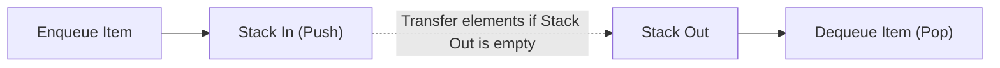

# 📚 Data Structures & Algorithms in Python (DSA)

A comprehensive repository containing practical implementations, algorithmic problem-solving notebooks, and time-complexity analyses for fundamental Data Structures and Algorithms implemented in Python 3.

---

## 📌 Repository Overview

This repository demonstrates foundational to intermediate algorithmic problem-solving across core computer science data structures:
- **Arrays & Lists:** Element traversal, dynamic insertion/deletion, frequency counting, deduplication, and mathematical operations.
- **Stacks (LIFO):** Array-based and dynamic implementations, parenthesis balancing, Next Greater Element, palindrome verification, and sorting algorithms.
- **Queues (FIFO):** List-based queues, Linked List implementations, double-ended queues, Queue using two Stacks, and Queue with `max()` support.
- **Real-World Applications:** Interactive **Undo/Redo System** using two complementary stacks, sentence word reversal, and recursive call simulations.

---

## 📂 Implementation Index by Topic

| Category | Notebook Implementation | Algorithmic Problem Solved |
| :--- | :--- | :--- |
| **Stacks** | `Undo_Redo System Using Two Stacks.ipynb` | Application state management using dual stacks |
| | `balance paranthesis.ipynb` | Bracket validation and matching using LIFO invariant |
| | `Next Greater Element .ipynb` | Monotonic stack implementation ($O(N)$ runtime) |
| | `Minimum element in the stack .ipynb` | Min-stack design supporting $O(1)$ minimum retrieval |
| | `check if a stack is a palindrome.ipynb` | Palindrome sequence verification |
| | `stack sort algorithm .ipynb` | Auxiliary stack sorting without external arrays |
| **Queues** | `Queue using Two Stacks.ipynb` | Amortized $O(1)$ FIFO queue using two LIFO stacks |
| | `Queue_using_linkedlist.ipynb` | Dynamic memory node-based pointer queue implementation |
| | `Design a Queue that Supports max() Operation.ipynb` | Double-ended monotonic queue tracking maximum element |
| | `Implement a Queue to Reverse Words in a Sentence.ipynb` | Tokenized string processing with queue FIFO ordering |
| | `merge2queues.ipynb` | Interleaving and sorted merging of two queue streams |
| **Arrays** | `array operations.ipynb` | Linear search, sliding window, and in-place mutations |
| | `_remove duplicate elements in array.ipynb` | In-place duplicate removal |
| | `finding max and min of an array.ipynb` | Minimum comparison bounds for extrema |
| **Recursion** | `Recursion(1).ipynb` | Call stack mechanics, divide-and-conquer, base cases |

---

## 🏗️ Architectural Concept: Queue via Two Stacks



---

## ⚙️ Running the Notebooks

### Prerequisites
- Python 3.8+
- Jupyter Notebook or VS Code

### Steps:

1. **Clone the repository:**
   ```bash
   git clone https://github.com/prakruthidevanga/Data-structures-using-python.git
   cd Data-structures-using-python
   ```

2. **Launch Jupyter Notebook:**
   ```bash
   jupyter notebook
   ```

3. Open any topic notebook (e.g., `Undo_Redo System Using Two Stacks.ipynb` or `Queue using Two Stacks.ipynb`) and run the test cases!

---

## 🛠️ Technology Stack

- **Language:** Python 3
- **Data Structures:** Arrays, Stacks, Queues, Linked Lists, Monotonic Deques
- **Environment:** Jupyter Notebook

---

## 👩‍💻 Author & Contributions

- **Author:** Prakruthi B R ([@prakruthidevanga](https://github.com/prakruthidevanga))
- **Program:** BCA (Specialization in Artificial Intelligence and Machine Learning), Alliance University.
- **Contributions:** Implemented all 30+ DSA problem solutions, handled boundary conditions, and analyzed algorithmic time and space complexities.
